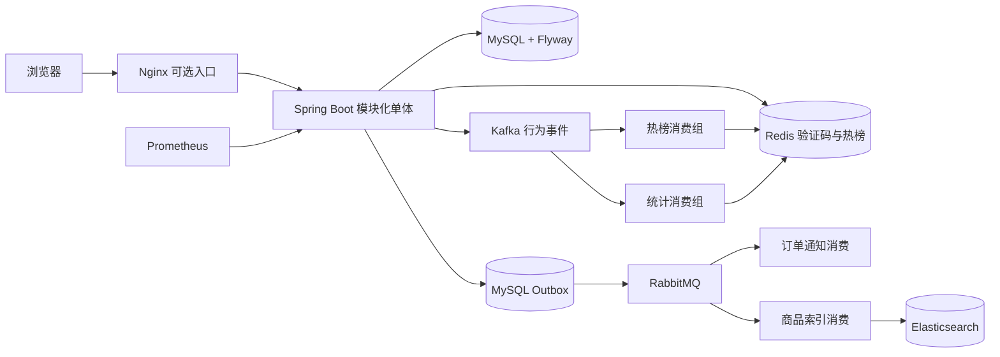

# CampusTrade

CampusTrade 是一个面向高校学生的模块化单体二手交易平台，支持线下交易申请、商品搜索、站内私信和 AI 辅助发布。后端使用 Java 17、Spring Boot 4.1、Spring Security/JWT、MyBatis、MySQL 8.4 与 Flyway；前端为原生 HTML/CSS/JavaScript。项目保留单体部署，以真实交易场景验证事务、并发控制、事件可靠性和可观测性。

## 当前已实现

- 邮箱验证码注册、登录、JWT 鉴权和禁用账号令牌即时失效。
- 商品发布、关键词/分类/价格筛选、分页、三种白名单排序、详情、在售编辑、个人发布列表和下架。
- 单商品最多 6 张 JPEG/PNG/WebP 图片；真实文件头、大小和权限校验；本地存储可替换。
- 买家申请购买、卖家接受/拒绝、超时释放、发货、确认成交，以及未发货订单的双方协商取消；订单分页与状态筛选。
- 订单通知中心、私信与未读状态、商品收藏；个人中心可修改昵称、密码及通过邮箱验证码重置密码。
- 条件更新防止并发重复购买，请求标识防止重复下单。
- Redis 验证码 TTL、发送冷却、错误次数限制和成功后防重放。
- Mailpit 本地 SMTP 联调、统一异常响应、Swagger UI 和自动化测试。
- 可选的 AI 辅助发布：根据原始描述建议标题、规范描述和已有分类；结构化输出二次校验，超时、瞬时重试、按用户限流且失败不阻塞手动发布。

## 架构与技术取舍



- **交易一致性：**订单创建通过事务与商品条件更新控制并发；请求键处理重复提交。商品能否交易最终以 MySQL 状态为准。
- **可靠业务事件：**订单通知与商品索引同步先在业务事务中写入 MySQL Outbox，再由发布器投递 RabbitMQ；发布确认、重试、死信和消费端去重应对重复投递及暂时故障。[设计与容器测试](docs/PRODUCT_SEARCH_EVENT_CHAIN.md)。
- **全文搜索：**Elasticsearch 提供标题/描述相关性、分类和价格筛选；商品变更事件同步索引，旧事件受版本校验约束，并支持全量重建。原 MySQL 搜索保留为基线与降级路径。
- **行为分析：**浏览和收藏发往 Kafka，两个独立消费者组分别处理 24 小时 Redis 热榜和统计。行为采集是非关键链路，Broker 不可用时浏览请求继续完成；故障期间事件可能丢失。[设计说明](docs/KAFKA_EVENT_STREAM.md)。
- **AI：**描述草稿、风险提示与受控查询工具均为可选能力。没有有效模型密钥时不能宣称真实模型联调成功；手动发布仍可用。

## 已验证的工程结果

| 验证 | 实际结果与边界 |
|---|---|
| Java 17 构建 | 2026-11-15 `mvnw test package` 成功；114 项测试中 84 通过、30 条件跳过、0 失败。 |
| 真实容器测试 | MySQL 订单并发 6/6、MySQL/RabbitMQ/Elasticsearch 事件链路及 Kafka/Redis 行为测试均已运行；各场景见[最终验收清单](docs/FINAL_ACCEPTANCE_2026-11-15.md)。 |
| 搜索性能 | 1 万条**合成**商品、10 VU/30 秒；MySQL 关键词接口 p95 由 71.71 ms 降至 32.53 ms。Elasticsearch 与 MySQL 排序/匹配语义不同，不直接比较吞吐；空关键词复测存在网络超时，不用于提升结论。[原始条件与结果](docs/PERFORMANCE_REPORT.md)。 |
| 正式部署冒烟 | 正式 Dockerfile 构建的 Java 17 镜像在全新 Compose 数据卷中完成两账号注册、发布、索引、热榜、通知及成交；Prometheus 抓取与 Redis/Kafka 故障指标验证通过。Grafana 页面、远端 GitHub Actions、公网 HTTPS 均未验收。[部署记录](docs/DEPLOYMENT_GUIDE.md)。 |

## 本地运行

安装 JDK 17 与 Docker Desktop；在项目根目录复制 `.env.example` 为 `.env`，填写随机数据库/RabbitMQ 密码和至少 32 字节随机密钥的 Base64 编码值。`.env` 不提交。首次体验邮件验证码使用 Compose 内 Mailpit，**不会发送到真实外部邮箱**。

```powershell
$env:JAVA_HOME = 'C:\path\to\jdk-17'
.\mvnw.cmd -B test package
docker compose --env-file .env -f docker-compose.dev.yml up -d mysql redis rabbit mailpit
docker compose --env-file .env -f docker-compose.dev.yml --profile app up -d --build app
```

访问 `http://localhost:8080/`；本地测试邮件位于 `http://localhost:8025/`。要启用 ES/Kafka，先按[部署指南](docs/DEPLOYMENT_GUIDE.md)启动对应 profile 并设置开关，再重启应用。正式 Dockerfile 复制已打包 JAR，因此每次源码变化后都要重新执行 Maven 打包。不要在现有数据库重跑旧 `schema.sql`；MySQL profile 启动时由 Flyway 迁移。镜像、备份恢复和监控说明见[部署指南](docs/DEPLOYMENT_GUIDE.md)。

## 快速入口

- [部署与备份](docs/DEPLOYMENT_GUIDE.md) · [最终验收](docs/FINAL_ACCEPTANCE_2026-11-15.md) · [可观测性](docs/OBSERVABILITY.md) · [技术亮点](docs/PROJECT_TECH_HIGHLIGHTS.md) · [发布安全检查](docs/PUBLICATION_SECURITY_CHECK.md)
- V6 架构审计：[`docs/V6_ARCHITECTURE_AUDIT.md`](docs/V6_ARCHITECTURE_AUDIT.md)；[架构图与 ER 图](docs/V6_ARCHITECTURE.md)
- [V6 API](docs/V6_API.md) · [测试记录](docs/V6_TEST_REPORT.md) · [性能记录](docs/V6_PERFORMANCE.md) · [简历证据](docs/V6_RESUME_EVIDENCE.md)
- [全站 UI 改造记录与新旧截图](docs/UI_PRODUCT_REDESIGN.md)
- V3 现状审计：[`docs/V3_AUDIT.md`](docs/V3_AUDIT.md)
- V3 第一阶段记录：[`docs/V3_PHASE1.md`](docs/V3_PHASE1.md)
- V3 第二阶段记录：[`docs/V3_PHASE2.md`](docs/V3_PHASE2.md)
- V3 第三阶段记录：[`docs/V3_PHASE3.md`](docs/V3_PHASE3.md)
- V2 技术设计：[`docs/V2_TECHNICAL_NOTES.md`](docs/V2_TECHNICAL_NOTES.md)
- 页面：`http://localhost:8080/`
- Swagger UI：`http://localhost:8080/swagger-ui.html`
- Mailpit：`http://localhost:8025/`

## 测试

```powershell
$env:JAVA_HOME='C:\path\to\jdk-17'
$env:Path="$env:JAVA_HOME\bin;$env:Path"
.\mvnw.cmd test
```

普通测试使用独立 H2 数据库。Windows Edge 浏览器测试运行双账号流程；非 Windows 平台会跳过。需要真实 MySQL/Kafka/RabbitMQ 的测试有独立开关并使用 Testcontainers；默认测试中的条件跳过不得视为通过。对应命令和实测结果见[验收清单](docs/FINAL_ACCEPTANCE_2026-11-15.md)。

> 不要将数据库密码、JWT 密钥、SMTP 授权码或 AI API Key 提交到仓库。`.env` 已被忽略，`.env.example` 只提供变量名称。
