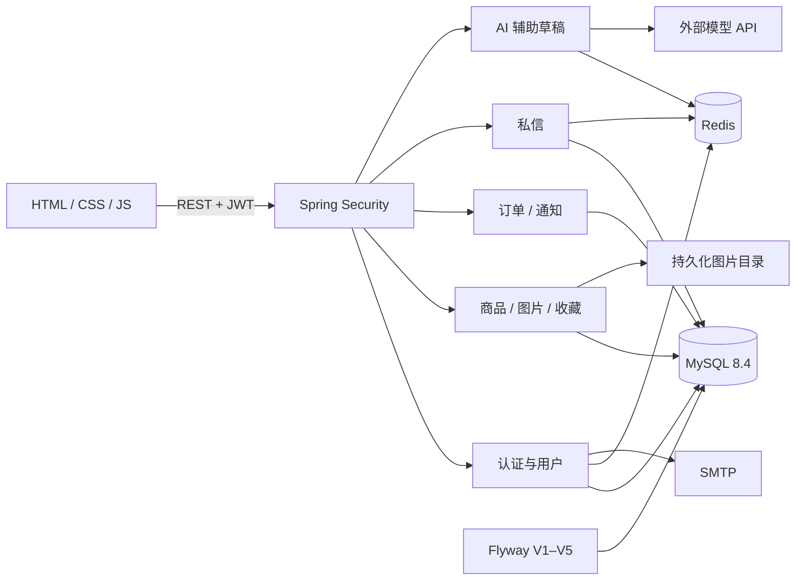
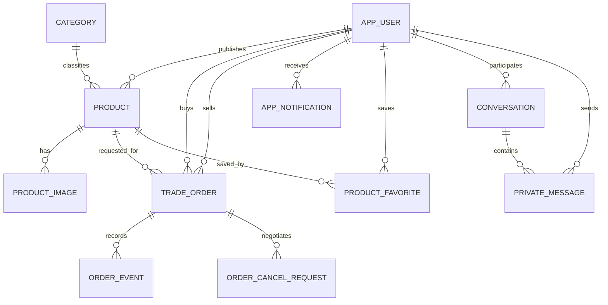

# V6 系统架构与数据关系

## 系统架构



所有业务模块同进程部署。`OrderService` 在一个数据库事务中修改订单、商品、事件和通知；Redis 只保存验证码与限流窗口，不作为订单状态来源。`FileStorage` 封装图片存储路径，应用容器需要挂载持久卷。浏览器 `api.js` 统一附带 JWT 和请求 ID，`orders-v5.js`、`profile.js`、`messaging.js` 分别处理页面交互。

## 核心 ER 图



`trade_order` 保存商品标题、描述、价格快照，避免之后商品变化使历史订单失真。`order_cancel_request` 可有多条历史，但同一时刻仅允许一条 `PENDING`：应用持有订单行 `FOR UPDATE` 锁再查找和插入。`order_event` 记录状态操作，`app_notification` 是面向收件人的持久提醒。`app_user.token_version` 随改密或重置递增，JWT 解码器每次与数据库比对，旧令牌立即失效。

数据库来源：`src/main/resources/db/migration/mysql/V1__create_v2_baseline_schema.sql` 至 `V5__user_token_version.sql`。H2 测试结构：`src/main/resources/db/schema.sql`。完整索引与约束以迁移 SQL 为准。

## 关键状态调用链与 SQL

卖家接受：`OrderController.accept` → `OrderService.accept` 的 `@Transactional` 与 `findByIdForUpdate` → `OrderMapper.acceptPending` 的条件更新 → `OrderEventMapper.insert` / `NotificationMapper.insert`。到期判断既在服务层给清楚错误，也在 SQL 层防止跨越截止时间：

```sql
UPDATE trade_order SET status = :targetStatus, accepted_at = CURRENT_TIMESTAMP
WHERE id = :id AND seller_id = :sellerId
  AND status = 'PENDING_SELLER_CONFIRMATION'
  AND (expires_at IS NULL OR (expires_at > :now AND expires_at > CURRENT_TIMESTAMP));
```

协商取消：`OrderController.proposeCancellation/acceptCancellation/rejectCancellation` → `OrderService` 锁定同一订单行 → `CancellationRequestMapper.findPending` → 插入或终结请求。接受时 `OrderMapper.cancelAfterAgreement` 将订单改为 `CANCELLED`，`ProductMapper.releaseAfterCancellation` 将 `RESERVED` 改为 `ON_SALE`，再写 `order_event` 与 `app_notification`；任何一步抛错，数据库事务整体回滚。待处理请求期间 `ship` 和 `complete` 均返回冲突。MySQL V4 核心索引：

```sql
INDEX idx_cancel_request_order_status (order_id, status, id)
```

通知：`NotificationController` → `NotificationService` → `NotificationMapper`，查询和已读 SQL 始终绑定 `user_id`。密码操作：`AuthController` → `AuthService` → `UserMapper`，更新密码时执行 `token_version = token_version + 1`；`SecurityConfig` 在 JWT 解码时查询当前版本并比对。验证码摘要在 Redis 中保存 5 分钟，成功后 Lua 原子删除，重放返回过期/已使用；本地 profile 为内存与控制台邮件，仅供开发。
